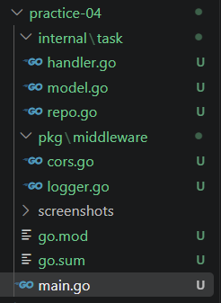
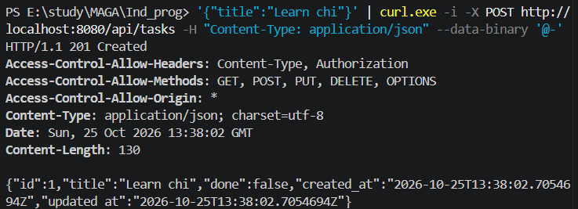
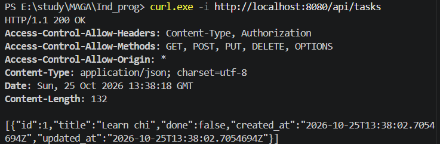
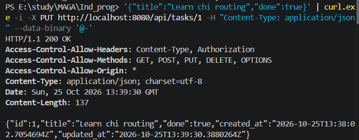
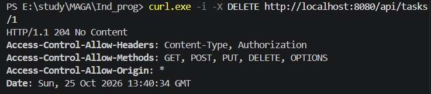
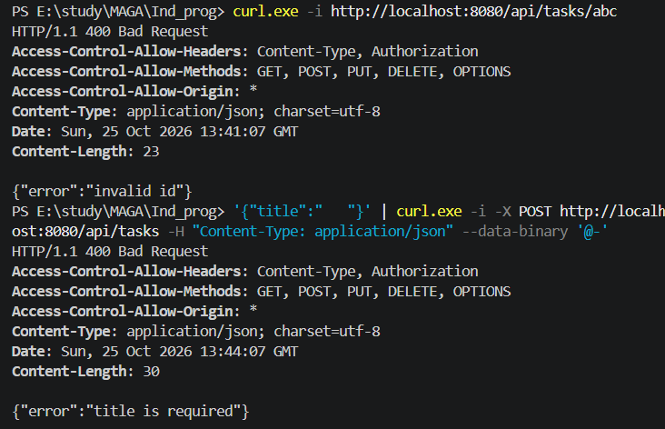
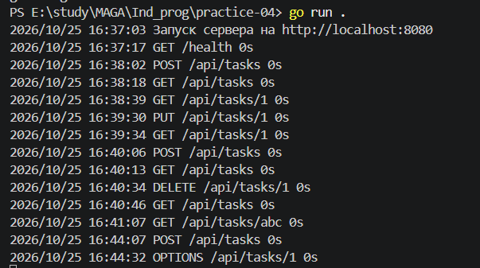
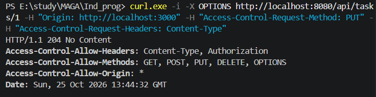

# Практическая работа 4

## Боровская В.В. ЭФМО-01-26


## Цель работы

Освоить маршрутизацию с chi, реализовать создание, чтение, обновление и удаление задач, подключить логирование и CORS, проверить HTTP-ответы сервера.

## Структура проекта

```text
practice-04/
├── main.go
├── go.mod
├── go.sum
├── internal/task/
│   ├── model.go
│   ├── repo.go
│   └── handler.go
├── pkg/middleware/
│   ├── logger.go
│   └── cors.go
├── screenshots/
└── README.md
```

В `main.go` создаются компоненты и подключаются маршруты. Пакет `task` содержит модель, хранилище и HTTP-обработчики, а `pkg/middleware` — общие обёртки запросов. Имя модуля — `borovskaya/pr4`.



## Запуск и сборка

Требуется Go 1.27.1 или новее согласно `go.mod`. Используется chi v5.5.0. Команды выполняются из папки `practice-04` в PowerShell:

```powershell
go mod download
go run .
```

Сервер доступен на `http://localhost:8080`. Для остановки используется `Ctrl+C`. Перед запуском нужно освободить порт, если его занимает другая практика.

Проверка и сборка:

```powershell
go fmt ./...
go vet ./...
go build -o bin/todo.exe .
.\bin\todo.exe
```

Перед запуском `.exe` остановите ранее запущенный сервер. Данные находятся в памяти и после перезапуска исчезают.

## Модель и хранилище

Задача содержит `id`, `title`, `done`, `created_at` и `updated_at`. ID увеличивается при создании записи; даты хранятся в UTC. При обновлении изменяется `updated_at`, а `created_at` сохраняется.

Хранилище использует `map[int64]Task` и `sync.RWMutex`: чтение выполняется под `RLock`, изменение — под `Lock`. Наружу возвращаются копии задач, поэтому HTTP-обработчики не изменяют внутренние записи напрямую. Порядок элементов списка не гарантируется.

## Маршрутизация

Роутер задач подключается к общему префиксу:

```go
router.Route("/api", func(api chi.Router) {
    api.Mount("/tasks", handler.Routes())
})
```

Внутри `Routes()` зарегистрированы пять операций:

```go
r.Get("/", h.list)
r.Post("/", h.create)
r.Get("/{id}", h.get)
r.Put("/{id}", h.update)
r.Delete("/{id}", h.delete)
```

Параметр `id` извлекается через `chi.URLParam(r, "id")` и преобразуется в положительное целое число. В отличие от ручного разделения пути, получение параметра выполняет роутер.

## Создание задачи

POST принимает JSON с названием. Обработчик декодирует тело, удаляет пробелы по краям и отклоняет пустое название. После проверки он вызывает хранилище:

```go
task := h.repo.Create(req.Title)
writeJSON(w, http.StatusCreated, task)
```

Запрос в PowerShell:

```powershell
'{"title":"Learn chi"}' | curl.exe -i -X POST http://localhost:8080/api/tasks -H "Content-Type: application/json" --data-binary '@-'
```

Ожидается `201 Created`, новый ID, `done: false` и даты создания и обновления. На скриншоте создана задача с ID 1. Передача JSON через стандартный ввод позволяет избежать различий экранирования кавычек в PowerShell.



## Чтение задач

Получение списка:

```powershell
curl.exe -i http://localhost:8080/api/tasks
```

Ожидается `200 OK` и массив задач. На скриншоте массив содержит созданную задачу.



Получение одной задачи:

```powershell
curl.exe -i http://localhost:8080/api/tasks/1
```

Ожидается `200 OK` и один объект вместо массива. В логах есть обращения к этому маршруту, но отдельный снимок тела ответа пока не приложен. Если ID созданной задачи отличается, его нужно подставить в запрос.

## Обновление задачи

PUT заменяет редактируемые поля `title` и `done`. При пропуске `done` декодер оставит значение `false`, поэтому для этой операции передаются оба поля.

```powershell
'{"title":"Learn chi routing","done":true}' | curl.exe -i -X PUT http://localhost:8080/api/tasks/1 -H "Content-Type: application/json" --data-binary '@-'
```

Ожидается `200 OK`. На снимке название изменено на `Learn chi routing`, `done` равен `true`, дата создания сохранена, дата обновления изменилась.



Для проверки сохранения изменений выполняется повторное чтение:

```powershell
curl.exe -i http://localhost:8080/api/tasks/1
```

## Удаление задачи

```powershell
curl.exe -i -X DELETE http://localhost:8080/api/tasks/1
```

Успешный ответ — `204 No Content` без тела. Обработчик вызывает `repo.Delete(id)` и отправляет только статус.



Повторное получение удалённой задачи должно вернуть `404 Not Found` и `{"error":"task not found"}`:

```powershell
curl.exe -i http://localhost:8080/api/tasks/1
```

Отдельный снимок ответа 404 пока не приложен.

## Обработка ошибок

Ошибки обработчиков задач возвращаются в едином формате:

```json
{"error":"сообщение"}
```

Функция `httpError` передаёт статус и сообщение в `writeJSON`. JSON формируется до отправки заголовков: если преобразование не удалось, можно вернуть `500`. Ошибки записи ответа сохраняются в журнале.

Проверка ID и пустого названия:

```powershell
curl.exe -i http://localhost:8080/api/tasks/abc
'{"title":"   "}' | curl.exe -i -X POST http://localhost:8080/api/tasks -H "Content-Type: application/json" --data-binary '@-'
```

Оба запроса должны вернуть `400 Bad Request`. На скриншоте видны сообщения `invalid id` и `title is required`.



Некорректный JSON также обрабатывается со статусом 400, а отсутствие задачи при чтении, обновлении или удалении — со статусом 404. Проверка Content-Type запроса отдельно не реализована; при POST и PUT клиент передаёт `application/json`.

## Логирование

Логгер оборачивает следующий обработчик и измеряет время его выполнения:

```go
start := time.Now()
next.ServeHTTP(w, r)
log.Printf("%s %s %s", r.Method, r.URL.Path, time.Since(start))
```

В журнал попадают метод, путь и длительность. Статус ответа этот логгер не записывает. На предоставленном снимке длительность отображается как `0s`; эти значения не используются для выводов о производительности.



Кроме собственного логгера подключены `chimw.RequestID` для идентификатора в контексте запроса и `chimw.Recoverer` для перехвата паник в последующих обработчиках.

## CORS

`SimpleCORS` устанавливает разрешённые источники, методы и заголовки. Предварительный запрос OPTIONS завершается до вызова основного обработчика:

```go
if r.Method == http.MethodOptions {
    w.WriteHeader(http.StatusNoContent)
    return
}
next.ServeHTTP(w, r)
```

Проверка предварительного запроса для PUT:

```powershell
curl.exe -i -X OPTIONS http://localhost:8080/api/tasks/1 -H "Origin: http://localhost:3000" -H "Access-Control-Request-Method: PUT" -H "Access-Control-Request-Headers: Content-Type"
```

Ожидается `204 No Content` и заголовки `Access-Control-Allow-Origin: *`, `Access-Control-Allow-Methods`, `Access-Control-Allow-Headers`. Они присутствуют на снимке. curl показывает ответ сервера, но сам не применяет браузерные ограничения CORS.



## Результаты тестирования

Фактические результаты ниже приведены по приложенным снимкам. Наличие строки запроса в журнале без статуса и тела не подтверждает корректность ответа.

| Маршрут | Запрос или данные | Ожидаемый ответ | Фактический результат |
|---|---|---|---|
| POST `/api/tasks` | `title: Learn chi` | 201, новая задача | 201, задача ID 1 |
| GET `/api/tasks` | Без параметров | 200, массив | 200, массив с задачей ID 1 |
| GET `/api/tasks/1` | Существующая задача | 200, объект | Запрос есть в логе; снимка ответа нет |
| PUT `/api/tasks/1` | Новое название, `done: true` | 200, изменённая задача | 200, поля и updated_at изменены |
| DELETE `/api/tasks/1` | ID 1 | 204, без тела | 204, тело отсутствует |
| GET `/api/tasks/1` | После удаления | 404, JSON-ошибка | Снимка ответа нет |
| GET `/api/tasks/abc` | Нечисловой ID | 400, invalid id | Совпадает |
| POST `/api/tasks` | Название из пробелов | 400, title is required | Совпадает |
| OPTIONS `/api/tasks/1` | Preflight для PUT | 204, CORS-заголовки | Совпадает |

## Выводы

Реализован сервис с пятью CRUD-операциями, группировкой маршрутов chi, логированием и CORS. Проверки показали создание, получение списка, обновление и удаление задач, а также обработку некорректного ID и пустого названия. Основные технические моменты — согласование HTTP-статусов с результатами операций, возврат копий задач из хранилища и передача JSON через PowerShell.

Данные пока не сохраняются между запусками, пагинация и фильтрация не реализованы. Следующими улучшениями могут стать постоянное хранение, автоматические тесты и ограничение размера входного тела. В обработчике `/health` остаётся опечатка в Content-Type: `test/plain` следует заменить на `text/plain`.