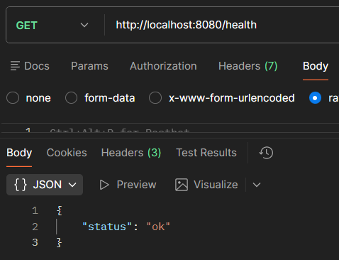
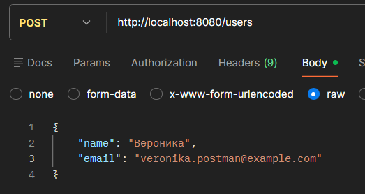
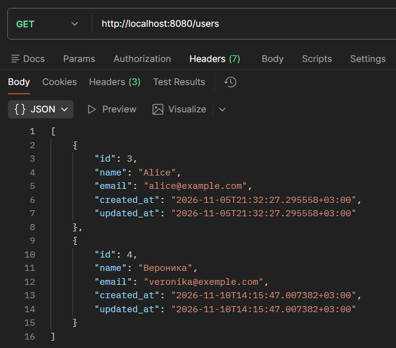
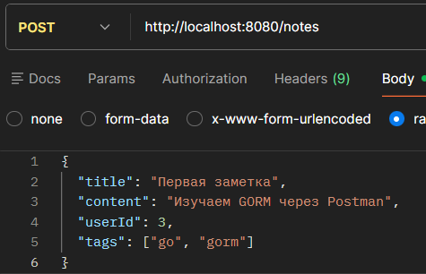
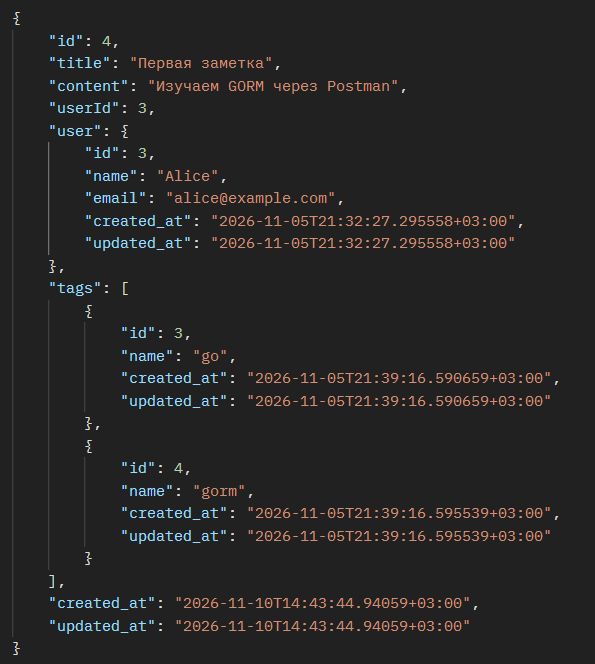
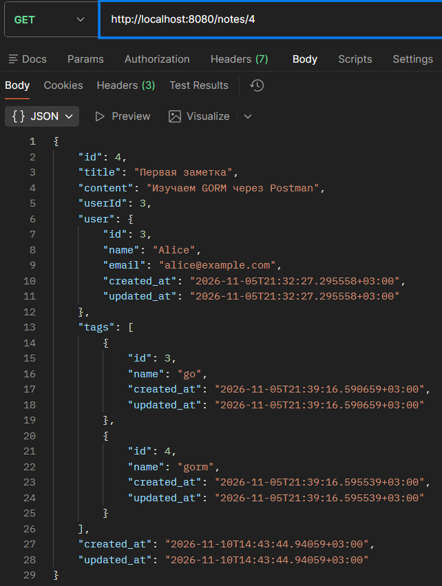
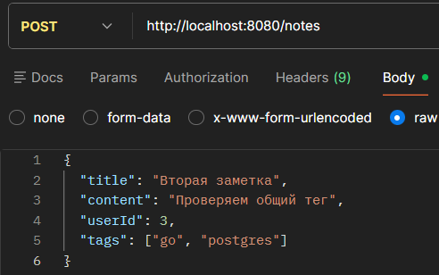
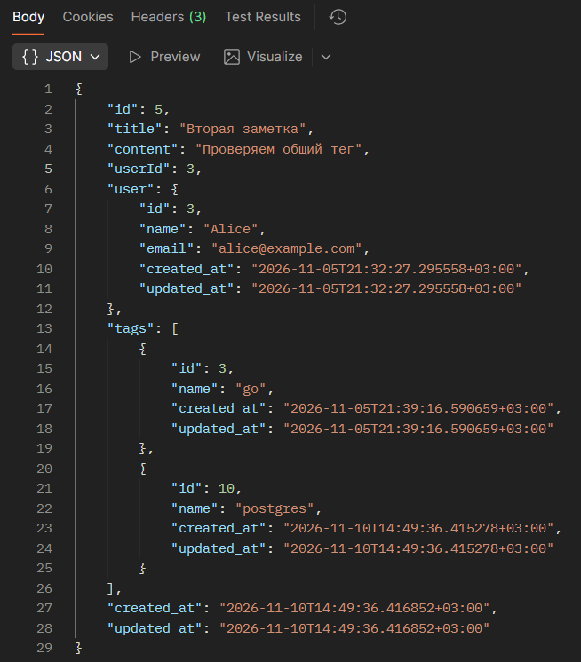
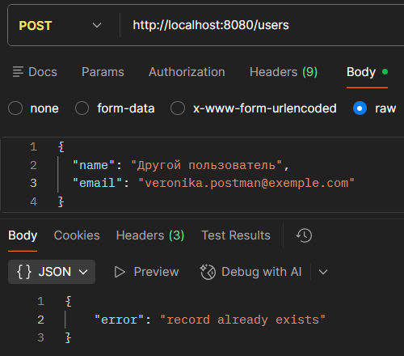
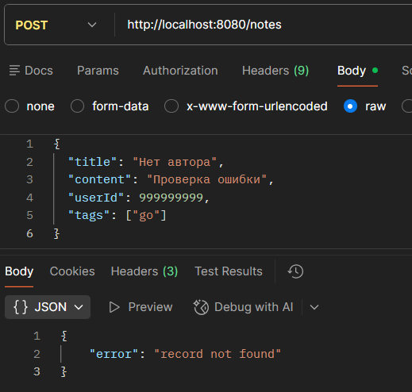

# Практическая работа 6

Боровская В.В. ЭФМО-01-26

## ORM и GORM

Сервис заметок использует GORM для сопоставления Go-структур с таблицами PostgreSQL. В отличие от пятой практики, типовые INSERT и SELECT формируются библиотекой. Связи описаны полями моделей и тегами, а AutoMigrate создаёт таблицы и ограничения. ORM сокращает повторяющийся код, но требует понимания SQL, транзакций и стоимости запросов.

## Структура

```text
cmd/server/main.go          запуск, конфигурация, миграции
cmd/setup/main.go           однократная локальная подготовка базы
internal/db/postgres.go    подключение и пул
internal/models/models.go модели User, Note, Tag
internal/httpapi/router.go маршруты chi
internal/httpapi/handlers.go JSON, проверки, транзакции, Preload
integration_test.go       тест API на PostgreSQL с откатом записей
```

Модуль: borovskaya/pr6. База: pz6_gorm. Таблица users связана с notes через user_id (1:N). Таблицы notes и tags связаны через note_tags (M:N). Обратные поля Notes не сериализуются в JSON, чтобы не раздувать ответы вложенными связями.

## Настройка

Требуются Go согласно go.mod и PostgreSQL. Для нового компьютера создайте базу pz6_gorm через pgAdmin. Скопируйте .env.example в .env и заполните DB_DSN своим локальным подключением:

```dotenv
DB_DSN=host=localhost port=5432 user=postgres password=YOUR_PASSWORD dbname=pz6_gorm sslmode=disable
PORT=8080
```

Вспомогательная команда go run ./cmd/setup использует параметры из ../practice-05/.env, создаёт отдельную базу при отсутствии и не перезаписывает существующий .env.

```powershell
go mod download
go run ./cmd/server
```


## Проверка API в Postman

### 1. Проверка сервера

**GET** `http://localhost:8080/health`

Ожидается **200 OK**:

```json
{"status":"ok"}
```



### 2. Создание пользователя

**POST** `http://localhost:8080/users`

```json
{
  "name": "Вероника",
  "email": "veronika.postman@example.com"
}
```

Ожидается **201 Created**. Если этот email уже существует, используйте другой или найдите созданного пользователя следующим запросом.



### 3. Список добавленных пользователей

**GET** `http://localhost:8080/users`

Ожидается **200 OK** и массив пользователей по возрастанию id. Каждый объект содержит id, name, email, created_at и updated_at. При отсутствии пользователей возвращается `[]`. 

Найдите нужного пользователя по email и используйте его id в поле userId следующего запроса.



### 4. Создание заметки с тегами

**POST** `http://localhost:8080/notes`

```json
{
  "title": "Первая заметка",
  "content": "Изучаем GORM через Postman",
  "userId": 3,
  "tags": ["go", "gorm"]
}
```

Ожидается **201 Created**. В ответе представлены заметка, объект user и массив tags.




### 5. Получение заметки

**GET** `http://localhost:8080/notes/5`

Ожидается **200 OK**, автор и теги подгружены через Preload.



### 6. Вторая заметка с общим тегом

**POST** `http://localhost:8080/notes`

```json
{
  "title": "Вторая заметка",
  "content": "Проверяем общий тег",
  "userId": 3,
  "tags": ["go", "postgres"]
}
```

Ожидается **201 Created**. Две заметки одного автора демонстрируют 1:N. Одинаковый ID тега go в двух заметках подтверждает повторное использование тега и связь M:N.




### 7. Повторный email

**POST** `http://localhost:8080/users`

```json
{
  "name": "Другой пользователь",
  "email": "veronika.postman@example.com"
}
```

Если email уже создан на шаге 2, ожидается **409 Conflict**:

```json
{"error":"record already exists"}
```



### 8. Пустой пользователь

**POST** `http://localhost:8080/users`

```json
{"name":"","email":""}
```

Ожидается **400 Bad Request**. 

### 9. Некорректный ID заметки

**GET** `http://localhost:8080/notes/abc`

Ожидается **400 Bad Request** и `{"error":"bad id"}`.


### 10. Несуществующая заметка

**GET** `http://localhost:8080/notes/999999999`

Если записи нет, ожидается **404 Not Found** и `{"error":"record not found"}`.


### 11. Несуществующий автор

**POST** `http://localhost:8080/notes`

```json
{
  "title": "Нет автора",
  "content": "Проверка ошибки",
  "userId": 999999999,
  "tags": ["go"]
}
```

Если такого автора нет, ожидается **404 Not Found**. Заметка не создаётся.




## Ошибки и целостность

Неверные данные и ID дают 400, отсутствующий автор или заметка — 404, повторный email — 409. Внутренние ошибки дают 500 без SQL и реквизитов подключения в ответе. DB_DSN проверяется при запуске; используется PingContext и общий пул 20/10 соединений с временем жизни один час, как в методичке.

Создание тегов, заметки и связей выполняется в одной транзакции. Повторяющиеся имена тегов нормализуются и удаляются из входного списка. Уникальность имени в базе и ON CONFLICT защищают от дублирования при параллельных запросах. Ошибки создания тегов не игнорируются.

## Проверки

```powershell
go vet ./...
go test -count=1 -v ./...
go build ./cmd/server
```
