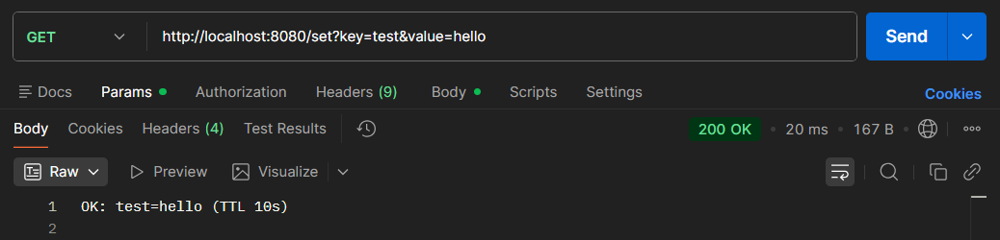
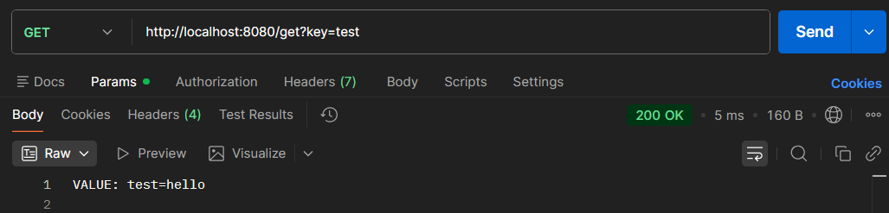
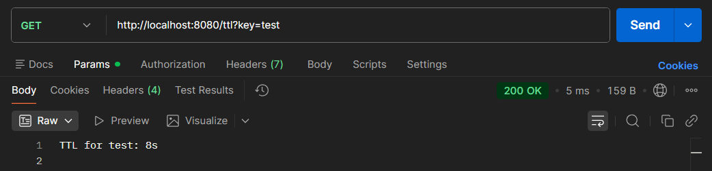
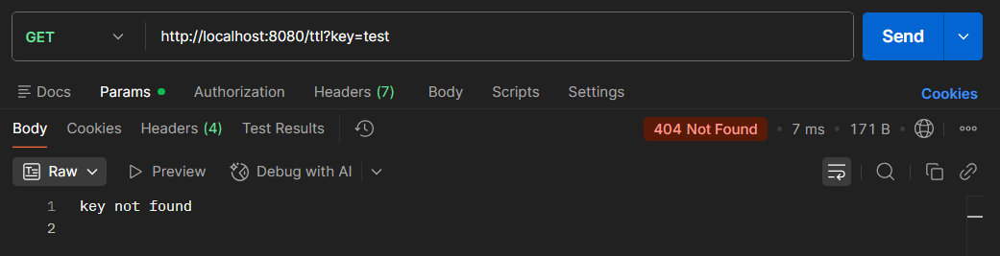

# Практическая работа 7

Боровская В.В. ЭФМО-01-26

Go-сервис сохраняет строки в Redis, читает их по ключу и показывает оставшийся срок жизни. Запись через API получает TTL 10 секунд. После истечения TTL ключ больше недоступен.

Redis хранит данные в памяти и поддерживает операции «ключ — значение». Кэш позволяет повторно использовать ранее полученные данные и уменьшать число обращений к основному источнику. TTL ограничивает срок хранения, но не обновляет данные автоматически. Значения записывает пользователь через `/set`.

## Структура

```text
practice-07/
  cmd/server/main.go       запуск и HTTP-обработчики
  internal/cache/cache.go  клиент Redis и операции с ключами
  go.mod                   модуль и версии зависимостей
  go.sum                   контрольные суммы зависимостей
  bin/server.exe           результат локальной сборки
  screenshots/             скриншоты проверок
```


## Подготовка и первый запуск

1. Запустить Docker Desktop и дождаться готовности движка.
2. Перейти в папку проекта:

```powershell
cd E:\study\MAGA\Ind_prog\practice-07
go version
docker version
go mod download
```

3. Создание контейнера Redis при первом запуске, если его ещё нет:

```powershell
docker run -d --name practice-07-redis -p 127.0.0.1:6379:6379 redis:7-alpine
```
Для существующего контейнера использовать:

```powershell
docker start practice-07-redis
docker exec practice-07-redis redis-cli PING
```

4. Запустить HTTP-сервер:

```powershell
go run ./cmd/server
```

```text
Redis connected: 127.0.0.1:6379
Server listening: http://127.0.0.1:8080
```
5. Остановка контейнера:

```powershell
docker stop practice-07-redis
```

## Сборка и проверка кода

Из папки практики:

```powershell
go vet ./...
go build -o bin/server.exe ./cmd/server
.\bin\server.exe
```

## Настройки


Пример запуска на другом порту:

```powershell
$env:PORT = '8081'
$env:REDIS_ADDR = '127.0.0.1:6379'
go run ./cmd/server
```

Запросы в этом случае отправлять на `http://localhost:8081`.

После остановки сервера вернуть значения по умолчанию:

```powershell
Remove-Item Env:PORT -ErrorAction SilentlyContinue
Remove-Item Env:REDIS_ADDR -ErrorAction SilentlyContinue
```

## Проверка API в Postman


### Запись

```text
GET http://localhost:8080/set?key=test&value=hello
```



### Чтение до истечения TTL

Сразу после записи:

```text
GET http://localhost:8080/get?key=test
```



### Оставшийся срок жизни

```text
GET http://localhost:8080/ttl?key=test
```



### Истечение TTL

После `/set` подождать больше 10 секунд без повторной записи и выполнить:

```text
GET http://localhost:8080/get?key=test
```


## Команды Redis в терминале

Эти команды работают напрямую с Redis, без Go-сервера. 

```powershell
docker exec practice-07-redis redis-cli PING
docker exec practice-07-redis redis-cli SET demo hello EX 10
docker exec practice-07-redis redis-cli GET demo
docker exec practice-07-redis redis-cli TTL demo
```

Ожидается `PONG`, `OK`, `hello` и оставшееся число секунд. После истечения срока GET возвращает отсутствие значения, TTL возвращает `-2`.

## Контрольные вопросы

1. **Чем Redis отличается от реляционной БД?** Redis предоставляет структуры данных и команды работы с ключами, а реляционная БД организует данные в таблицы и поддерживает SQL, связи и ограничения. Redis обычно обслуживает данные из памяти; возможна настройка сохранения на диск.
2. **Какие структуры есть кроме строк?** Списки, множества, сортированные множества, хэши, потоки. Также есть операции над битовыми полями и геоданными.
3. **Зачем TTL?** Чтобы ограничить срок хранения временных данных: кэш ответа API, одноразовый код, сессия. TTL сам по себе не гарантирует актуальность значения до истечения срока.
4. **Как снизить нагрузку на PostgreSQL?** Сначала искать данные в Redis; при отсутствии читать PostgreSQL и сохранять результат в Redis с TTL. 
5. **Что происходит после истечения TTL?** Ключ становится недоступен. go-redis возвращает `redis.Nil` при GET; сервис отвечает 404. При использовании кэша перед основной БД приложение могло бы получить данные из неё повторно.


