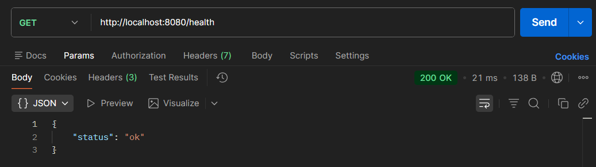
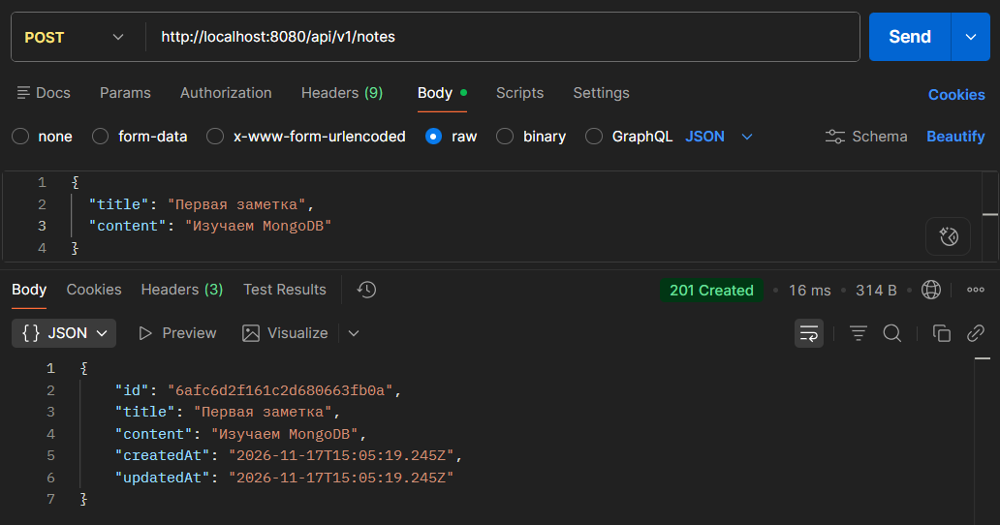
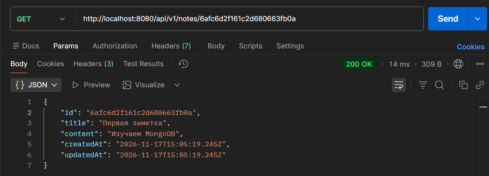
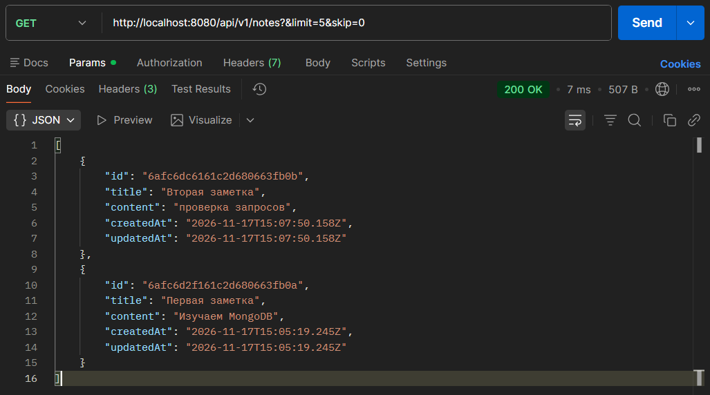
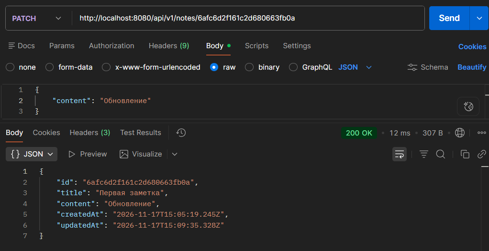
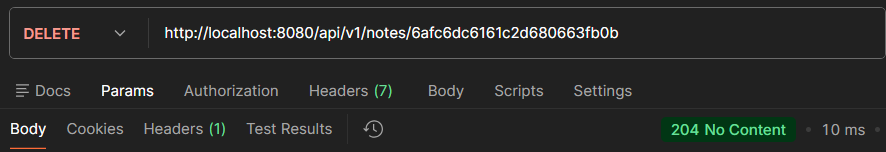
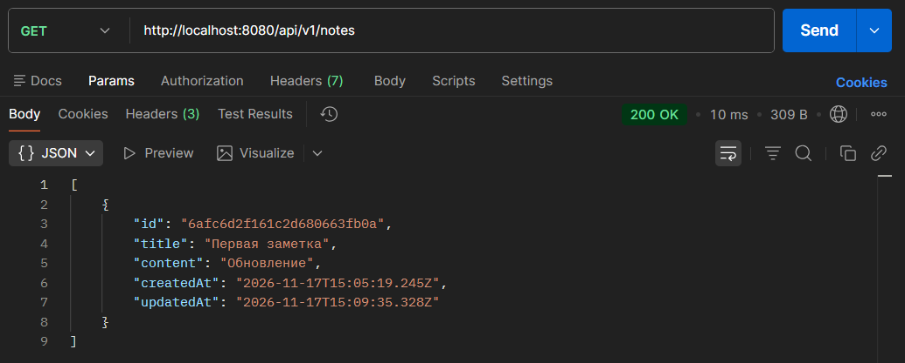

# Практическая работа 8

Боровская В.В. ЭФМО-01-26

## Назначение

REST-сервис заметок на Go с MongoDB. Реализованы создание, чтение, поиск по заголовку, пагинация, частичное обновление и удаление. Заголовки уникальны. Данные хранятся в базе `pz8`, коллекции `notes`.

MongoDB хранит BSON-документы в коллекциях. Модель заметки содержит ObjectID, заголовок, текст и даты создания и изменения. Теги `bson` определяют имена полей базы, а `json` - имена в HTTP-ответе. HTTP-обработчики проверяют запросы и вызывают репозиторий, который выполняет операции MongoDB.

слово - слово 
## Структура

```text
cmd/api/main.go              конфигурация, маршруты и запуск сервера
cmd/api/integration_test.go  интеграционный тест API и MongoDB
internal/db/mongo.go         подключение, таймауты и Ping
internal/notes/model.go      модель заметки
internal/notes/repo.go       индекс, CRUD, поиск и пагинация
internal/notes/handler.go    HTTP-обработчики и JSON
docker-compose.yml           MongoDB 7 и том данных
.env.example                 пример конфигурации
.env                         локальная конфигурация, игнорируется Git
screenshots/                 результаты проверок в Postman
```

## Первый запуск

Запустить Docker Desktop. В терминале PowerShell VS Code:

```powershell
cd E:\...\practice-08
go mod download
docker compose up -d
docker compose ps
```

Проверка MongoDB:

```powershell
docker exec practice-08-mongo mongosh --quiet -u root -p secret --authenticationDatabase admin --eval 'db.runCommand({ping: 1})'
```

Запустить API из папки практики:

```powershell
go run ./cmd/api
```

## Сборка и тестирование

```powershell
go vet ./...
go build -o bin/api.exe ./cmd/api
.\bin\api.exe
```

### Проверка HTTP-сервера

```text
GET http://localhost:8080/health
```


### Создание заметки

```text
POST http://localhost:8080/api/v1/notes
```




### Поиск по id и список

```text
GET http://localhost:8080/api/v1/notes
GET http://localhost:8080/api/v1/notes&limit=5&skip=0
```




### Частичное обновление

```text
PATCH http://localhost:8080/api/v1/notes/<id>
```



### Удаление

```text
DELETE http://localhost:8080/api/v1/notes/<id>
```




## Просмотр MongoDB

Открыть консоль:

```powershell
docker exec -it practice-08-mongo mongosh -u root -p secret --authenticationDatabase admin
```

Далее команды вводятся в mongosh, не в PowerShell:

```javascript
show dbs
use pz8
show collections
db.notes.find().sort({createdAt: -1, _id: -1})
db.notes.getIndexes()
db.notes.countDocuments({})
exit
```

## Контрольные вопросы

1. **Чем документная модель MongoDB принципиально отличается от реляционной? Когда она удобнее?** 
В реляционной БД данные хранятся в таблицах с заданными столбцами, а связи задаются ключами. В MongoDB одна запись - BSON-документ с полями, вложенными объектами и массивами. Такая модель удобна, например, для каталога товаров, где у разных категорий разные характеристики.
2. **Что такое ObjectID и зачем нужен _id? Как корректно парсить/валидировать его в Go?** 
`_id` - уникальный идентификатор документа внутри коллекции. `ObjectID` - 12-байтовый тип, который в `API` представлен строкой из 24 шестнадцатеричных символов. В `Go` вызываем `bson.ObjectIDFromHex(id)` и проверяем ошибку. Корректный формат ID ещё не означает, что документ существует.
3. **Какие операции CRUD предоставляет драйвер MongoDB и какие операторы обновления вы знаете?** 
`InsertOne` создаёт документ, `FindOne` и `Find` читают, `UpdateOne` изменяет, `DeleteOne` удаляет. В нашем проекте `FindOneAndUpdate` изменяет документ и возвращает его. Операторы: `$set` задаёт значение поля, `$inc` увеличивает число, `$push` добавляет элемент массива, `$pull` удаляет элементы по условию.
4. **Как устроены индексы в MongoDB? Как создать уникальный индекс и чем он грозит при вставке?** 
Индекс хранит значения выбранных полей и ссылки на документы, позволяя находить данные без полного просмотра коллекции для подходящих запросов. В `Go` создаём индекс через `Indexes().CreateOne`, задавая `SetUnique(true)`. Повторяющийся `title` при вставке или обновлении вызывает ошибку `duplicate key`; наше `API` возвращает `409 Conflict`.
5. **Почему важно использовать context.WithTimeout при вызовах к базе? Что произойдет при его срабатывании?** 
Он ограничивает время ожидания операции: например, пять секунд вместо длительного ожидания недоступной базы. После истечения срока контекст отменяется, и драйвер возвращает ошибку. Это не откатывает уже выполненную запись: сервер мог сохранить изменение до того, как приложение получило ошибку ожидания.

